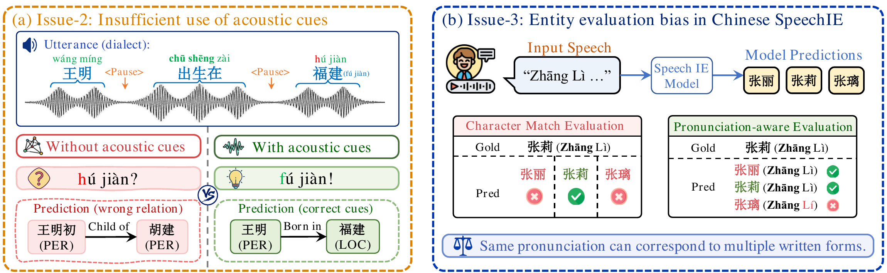
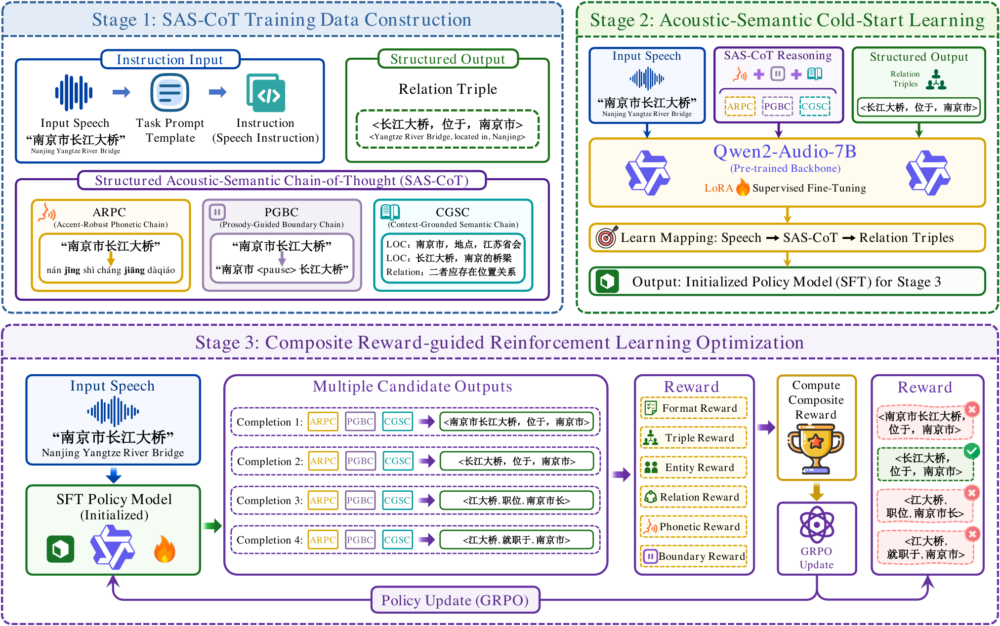

<div align="center">

# ACRE

**An Acoustic-Cue and Contextual-Knowledge Reasoning Enhancement Framework for Speech Relation Extraction**

<p>
  <a href="https://huggingface.co/datasets/DMU-ITREC/CSRTE-Speech"></a>
  
  
  
  
</p>

</div>

This repository contains the code for ACRE, a framework for speech relation extraction (SpeechRE), together with the evaluation scripts for the CSRTE benchmark.

ACRE fine-tunes Qwen2-Audio-7B to extract relational triples directly from speech. Before predicting the triples, the model generates a structured reasoning chain that covers pronunciation, pause boundaries and contextual knowledge. Training uses LoRA SFT followed by GRPO with a composite reward.

<p align="center">
  
</p>

## Overview

- **CSRTE.** A Chinese SpeechRE benchmark recorded by human speakers, with 49 relation types and about 20K utterances.
- **SAS-CoT.** A structured acoustic-semantic chain-of-thought made of three parts:
  - ARPC (Accent-Robust Phonetic Chain): pronunciation and tone cues.
  - PGBC (Prosody-Guided Boundary Chain): pause cues for entity boundaries.
  - CGSC (Context-Grounded Semantic Chain): contextual knowledge for entity disambiguation and relation reasoning.
- **Training.** LoRA SFT as a cold start, then GRPO with a composite reward over format, triplets, entities, relations, pronunciation and pauses.
- **PAE.** Pronunciation-aware evaluation, which matches entities by tone-aware pinyin rather than exact characters, to reduce homophone bias in Chinese.

<p align="center">
  
</p>

### Output format

```text
<think>{"pronunciation": "nán jīng shì cháng jiāng dà qiáo", "pause": "南京市 <pause> 长江大桥"}</think>
<answer>长江大桥##位于##南京市</answer>
```

Each triple is written as `head##relation##tail`. Multiple triples are joined with `$$`.

### Reward

`acre/reward.py` registers the MS-Swift reward plugin `speechre_acre_reward`:

| Component | Weight |
| :--- | :---: |
| Triplet F1 | 0.80 |
| Entity F1 | 0.05 |
| Relation F1 | 0.05 |
| Format (`<think>` JSON + `<answer>`) | 0.05 |
| Pronunciation similarity | 0.025 |
| Pause similarity | 0.025 |

Malformed or overly long outputs receive -0.1. The reward is also capped for repetitive outputs, for outputs with no correct triple on non-empty samples, and for low-quality reasoning chains.

## Dataset

| Dataset | Speech | #Rel. | Train | Dev | Test | Avg. length |
| :--- | :---: | :---: | ---: | ---: | ---: | :---: |
| CoNLL04-SpeechRE | TTS | 5 | 922 | 231 | 288 | 11.3s |
| ReTACRED-SpeechRE | TTS | 40 | 33,477 | 9,350 | 5,805 | 12.9s |
| CommonVoice-SpeechRE | Human | 45 | 14,557 | 2,495 | 2,494 | 11.6s |
| **CSRTE** | Human | 49 | 15,000 | 2,000 | 2,855 | 6.13s |

CSRTE is available on Hugging Face: [DMU-ITREC/CSRTE-Speech](https://huggingface.co/datasets/DMU-ITREC/CSRTE-Speech). It includes the speech recordings, transcriptions, entity annotations and relation annotations.

## Repository Structure

```text
ACRE/
├── acre/
│   ├── reward.py                    # GRPO reward plugin
│   └── evaluate.py                  # strict and PAE evaluation
├── configs/
│   └── paths.env.example            # path configuration template
├── patches/
│   └── ms-swift-qwen2-audio.patch   # Qwen2-Audio patch for MS-Swift
├── requirements/
│   ├── environment.txt
│   └── ms-swift-version.txt
├── scripts/
│   ├── train_sft.sh
│   ├── train_grpo.sh
│   └── evaluate.sh
└── assets/
```

## Installation

```bash
conda create -n acre python=3.11 -y
conda activate acre
pip install -r requirements/environment.txt
```

The code was tested with [MS-Swift](https://github.com/modelscope/ms-swift) `4.2.0.dev0` (exact revision in `requirements/ms-swift-version.txt`). MS-Swift is not bundled; install it from source and apply the Qwen2-Audio patch:

```bash
git clone https://github.com/modelscope/ms-swift.git
cd ms-swift && pip install -e . && cd ..
git -C ms-swift apply "$(pwd)/patches/ms-swift-qwen2-audio.patch"
```

Then set up local paths:

```bash
cp configs/paths.env.example configs/paths.env
vim configs/paths.env
source configs/paths.env
```

| Variable | Description |
| :--- | :--- |
| `BASE_MODEL` | Local path or hub ID of Qwen2-Audio-7B |
| `DATA_ROOT` | Directory containing `train.jsonl`, `dev.jsonl`, `test.jsonl` and audio |
| `OUTPUT_ROOT` | Output directory |
| `SFT_ADAPTER` | SFT LoRA checkpoint used to initialize GRPO |
| `GRPO_DATASET` | GRPO JSONL with a top-level `solution` field |
| `CUDA_VISIBLE_DEVICES` | GPUs to use |

## Training

**SFT.** Reads `${DATA_ROOT}/train.jsonl` and `${DATA_ROOT}/dev.jsonl` and saves the adapter to `${OUTPUT_ROOT}/sft`.

```bash
bash scripts/train_sft.sh
```

**GRPO.** Starts from the SFT adapter.

```bash
export SFT_ADAPTER=/path/to/sft/checkpoint
export GRPO_DATASET=/path/to/train_grpo.jsonl
bash scripts/train_grpo.sh
```

Default hyper-parameters:

| | SFT | GRPO |
| :--- | :--- | :--- |
| Learning rate | 2e-4 | 5e-6 |
| Epochs | 10 | 5 |
| Batch size × grad. accum. | 2 × 16 | 4 × 16 |
| LoRA | rank 8, alpha 32, all-linear | from SFT adapter |
| Others | max length 2048, bf16 | 4 generations, β = 0.04, temperature 1.0, top-p 0.95, vLLM colocate |

## Evaluation

```bash
bash scripts/evaluate.sh /path/to/checkpoint test
```

This runs greedy decoding with `swift infer` and then `acre/evaluate.py`. Metrics are saved to `${OUTPUT_ROOT}/eval/<split>_<ckpt>.metrics.json`:

- **Strict**: exact character match; precision, recall and F1 for triplets, entities and relations.
- **PAE**: entities are converted to tone-aware pinyin (e.g. `张莉 → zhang1 li4`) before matching.

To score an existing prediction file:

```bash
python acre/evaluate.py --result_path preds.jsonl --label_path test.jsonl
```

## Results

End-to-end SpeechRE under strict evaluation (F1, %), reported as Entity / Relation / Triplet.

| Method | CoNLL04 | ReTACRED | CommonVoice | CSRTE |
| :--- | :---: | :---: | :---: | :---: |
| GPT-4o-Audio (ICL) | 31.21 / 59.57 / 5.64 | 13.21 / 41.61 / 1.14 | 29.33 / 31.70 / 3.12 | 35.12 / 40.26 / 8.72 |
| Qwen2-Audio (SFT) | 48.12 / 81.85 / 34.73 | 38.54 / 64.08 / 11.62 | 46.80 / 60.19 / 24.69 | 52.17 / 76.44 / 29.95 |
| LNA-ED | 19.13 / 56.32 / 11.12 | 18.26 / 43.15 / 3.67 | 27.61 / 38.51 / 6.01 | 40.32 / 50.15 / 17.21 |
| MCAM | 40.66 / 77.61 / 22.71 | 35.61 / 59.13 / 8.21 | 45.34 / 50.34 / 15.71 | 46.13 / 62.13 / 21.52 |
| RPG-MoGe | 50.21 / 79.64 / 24.67 | 36.76 / 58.38 / 9.18 | 47.20 / 53.48 / 18.29 | 52.70 / 69.48 / 26.33 |
| ACRE (Qwen2.5-Omni-3B) | 56.28 / 82.90 / 37.41 | 37.91 / 62.88 / 12.96 | 49.52 / 63.18 / 27.12 | 51.89 / 74.36 / 31.68 |
| ACRE (Qwen2.5-Omni-7B) | 57.84 / 85.73 / 40.31 | 40.83 / **72.09** / 17.64 | **54.35** / 67.41 / 29.02 | 54.83 / 78.21 / 33.98 |
| ACRE (Qwen2-Audio-7B) | **58.09** / **87.14** / **42.07** | **44.72** / 71.24 / **19.96** | 53.66 / **69.58** / **30.41** | **54.90** / **79.63** / **35.75** |

## Citation

```bibtex
@article{ning2026acre,
  title  = {ACRE: An Acoustic-Cue and Contextual-Knowledge Reasoning Enhancement Framework for Speech Relation Extraction},
  author = {Ning, Jinzhong and Mu, Wenxuan and Zhao, Di and Zhang, Yijia and Lin, Hongfei},
  year   = {2026}
}
```

## Acknowledgements

This code builds on [Qwen2-Audio](https://github.com/QwenLM/Qwen2-Audio), [MS-Swift](https://github.com/modelscope/ms-swift), [TRL](https://github.com/huggingface/trl) and [vLLM](https://github.com/vllm-project/vllm).
